# Shopify Sections Library

A growing collection of custom, reusable Shopify Liquid sections — free to copy, customize, and use in your own theme.

Built and maintained by [Rubaeid](https://github.com/Rubaeid-Sanjid). Every section here was designed for real projects, cleaned up, and documented so anyone can drop it into their theme.

---

## 🔍 How to Use

1. Open the section folder you need (e.g. `sections/hero-banner/`)
2. Copy the `.liquid` file into your theme's `sections/` directory via Shopify CLI, Theme Kit, or the Shopify code editor
3. Read that section's own `README.md` for schema settings, dependencies, and customization notes
4. Adjust the schema settings from your theme customizer as needed

No attribution required, but a ⭐ on this repo is always appreciated.

---

## 📚 Sections

| Preview | Section | Description | Link |
|---|---|---|---|
|  | **Branding Grid** | Asymmetrical 5-image brand grid with a floating arched center portrait, plus a mobile stack/slider mode | [View](sections/branding-grid) |
|  | **Pricing Cards** | 4-card pricing/service grid with background images, overlays, and per-card CTAs, with a mobile swipe slider | [View](sections/pricing-cards) |
|  | **Rotating Testimonial** | 3D coverflow-style testimonial carousel with star ratings, verified badges, and prev/next navigation | [View](sections/rotating-testimonial) |
| 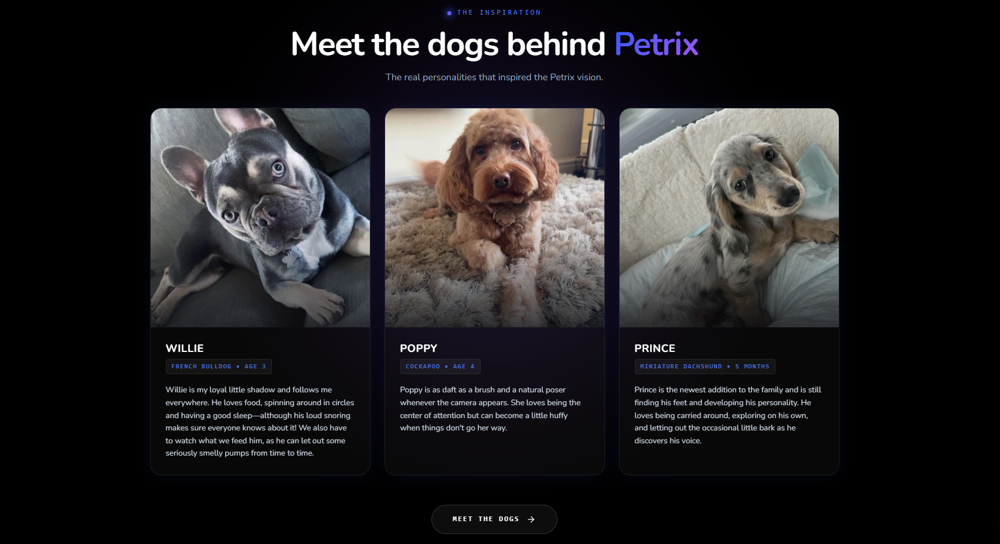 | **Meet the Dogs** | Compact storytelling card grid to introduce team members/pets with block-based cards and optional CTA | [View](sections/meet-the-dogs) |
| 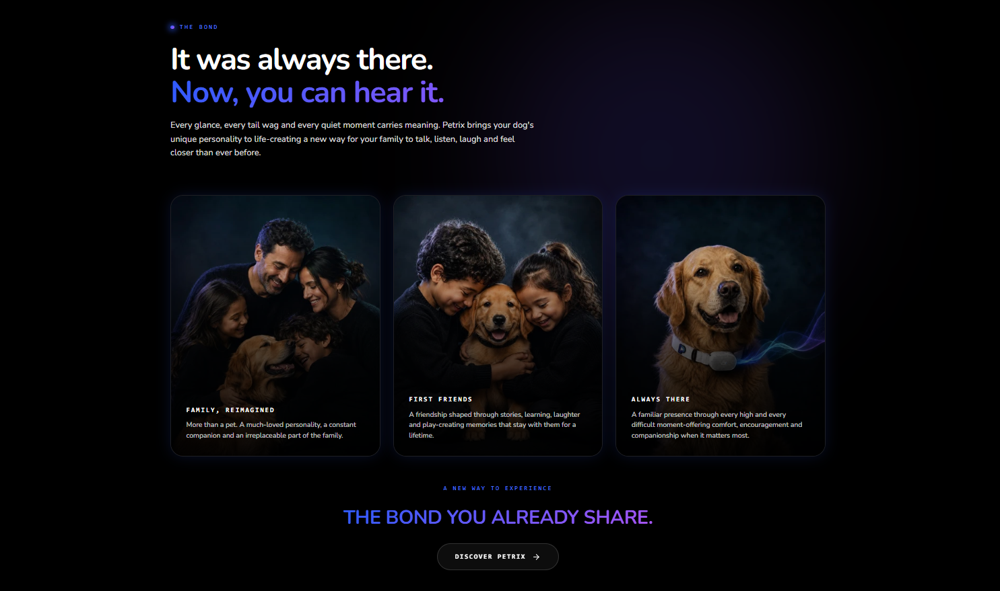 | **Lifestyle Showcase** | Full-width image showcase with flexible card overlays, captions, and responsive layout options | [View](sections/lifestyle-showcase) |
| 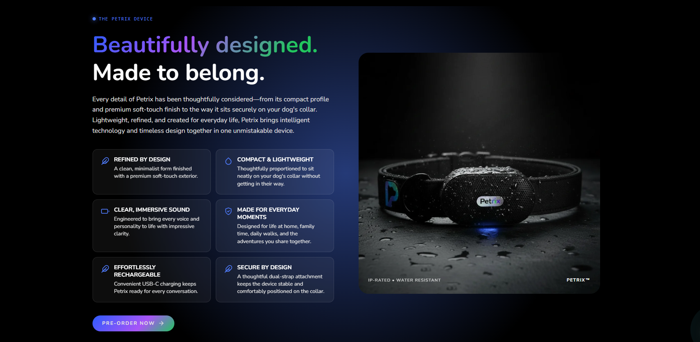 | **Image with Text (Gradient BG)** | Image and text split layout with gradient background options and responsive stacking for mobile | [View](sections/image_with_text_gradient_BG) |
| 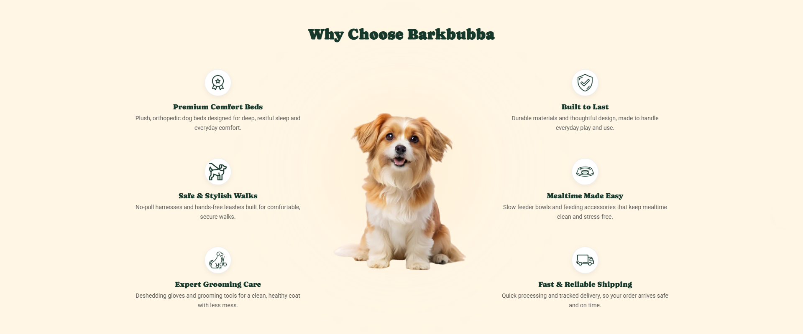 | **Why Choose Us (Center Features)** | 3-column feature section with a central hero subject (pet/product) flanked by 6 customizable benefit cards with built-in SVG icons | [View](sections/why-choose-us-features) |
| 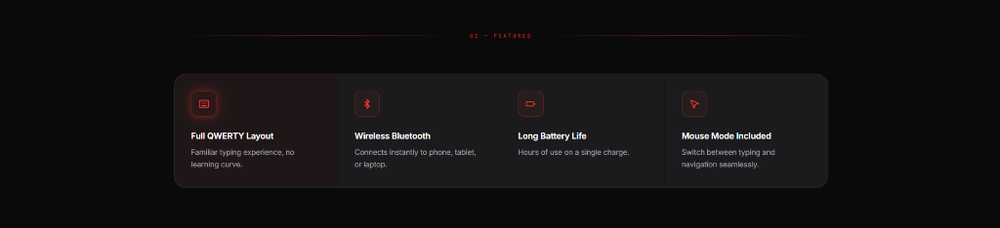 | **Laser Features Grid** | Cyberpunk-style dark feature grid with glowing laser line divider, customizable icon cards with neon glow hover effects, and responsive grid layout | [View](sections/laser-features-grid) |
|  | **Laser Line Divider** | Cyberpunk-style glowing laser beam divider with gradient fade lines, customizable uppercase monospace label, and optional pulse animation | [View](sections/laser-line-divider) |
| 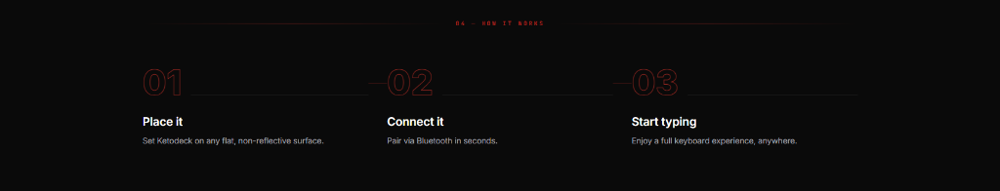 | **Laser How It Works** | Cyberpunk-style 3-step process section with outlined neon numbers, continuous timeline connector lines, and glowing laser header | [View](sections/laser-how-it-works) |
| 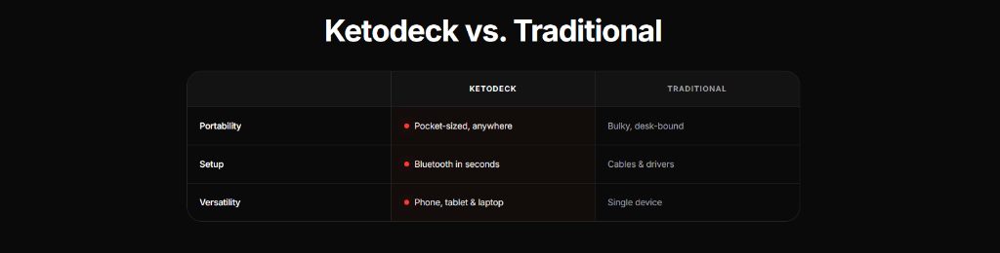 | **Ketodeck vs. Traditional** | Sleek cyberpunk product comparison matrix with glowing neon laser dot indicators, customizable columns, and dark rounded card styling | [View](sections/ketodeck-vs-traditional) |
| 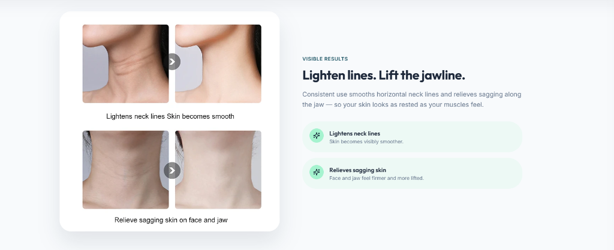 | **Visible Results Showcase** | Skincare & beauty before-and-after comparison card with visual proof pairs, floating arrow indicator, eyebrow, headline, and light mint benefit pills | [View](sections/visible-results-showcase) |
|  | **Dual Promo Cards** | High-converting 2-column promotional banner cards with pill badges, rich imagery, smooth gradient overlays, and arrow CTA links | [View](sections/dual-promo-cards) |
|  | **Community Stats** | Animated statistics counter highlighting milestone numbers, community size, and customer trust with customizable labels and CTA | [View](sections/custom_community_count) |
|  | **Title with Divider** | Elegant heading section flanked by customizable divider lines (solid, dashed, dotted, gradient) and custom decorative icons | [View](sections/title_with_divider) |
| 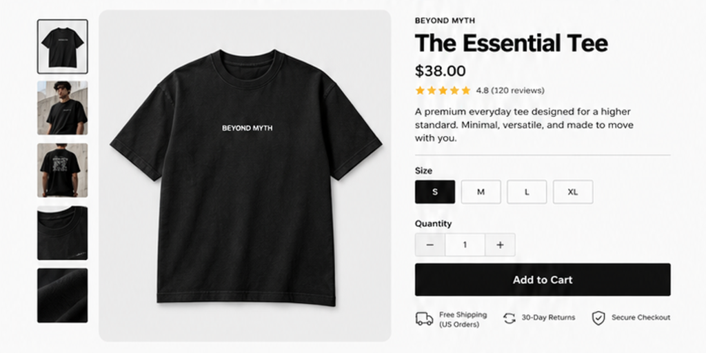 | **Featured Product** | High-converting minimal DTC product showcase with vertical thumbnail rail, size swatches, quantity stepper, AJAX cart CTA, and trust badges | [View](sections/featured-product) |
| 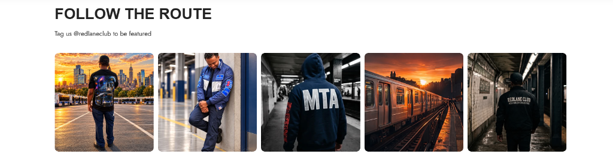 | **Instagram Feed & Slider** | Responsive Instagram showcase with centered icon hover micro-animation, interactive carousel/slider modes, custom links, and full schema styling | [View](sections/instagram-feed) |
| 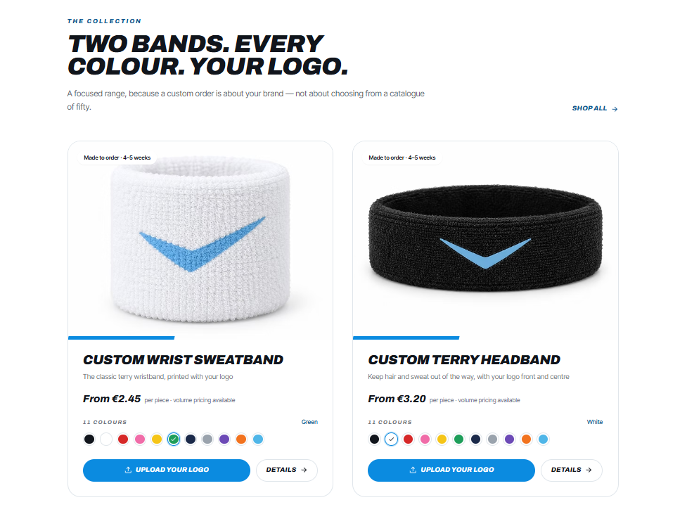 | **Custom Product Cards** | Dynamic 2-column merch showcase with interactive color swatches, fallback realistic vector SVGs, volume pricing notes, and live logo upload customizer modal | [View](sections/custom-product-cards) |
| 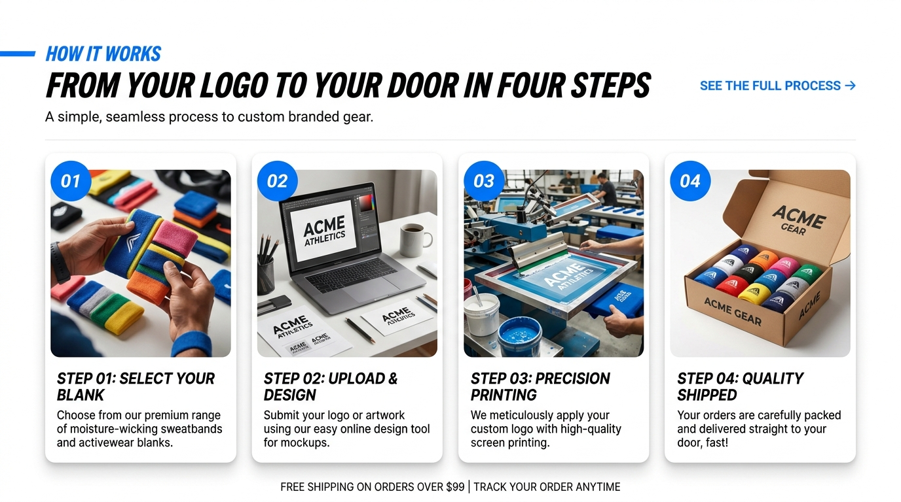 | **How It Works Steps** | High-converting 4-step process guide with athletic italic typography, customizable circular number badges, mobile swipe slider, and fallback SVGs | [View](sections/how-it-works-steps) |
| 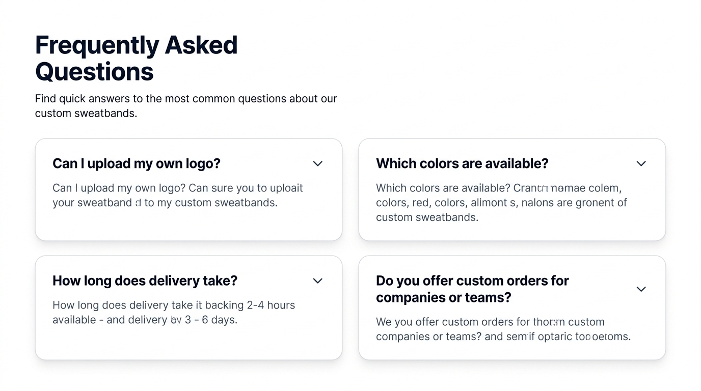 | **FAQ Accordion** | Modern 2-column expandable question card grid with smooth CSS transitions, Google FAQPage JSON-LD schema, and custom support footer | [View](sections/faq-accordion) |
| 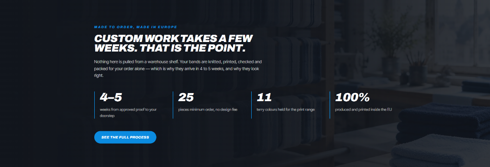 | **Made to Order Stats** | High-impact dark athletic banner with custom production lead time metrics, segmented vertical accent dividers, and pill CTA | [View](sections/made-to-order-stats) |

<!-- Add new rows above this line as you build new sections -->

---

## 🛠 Tech

- Shopify Liquid
- Vanilla JS / CSS (no framework dependencies unless noted per-section)
- Built and tested on Shopify Online Store 2.0 themes

## 📄 License

MIT — free to use, modify, and distribute.

## 🤝 Contributing

Found a bug or improved a section? PRs are welcome. Please follow the existing folder structure and include a preview image with any new section.
