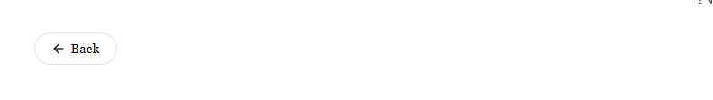

# Smart Back Button (Mobile & Desktop Navigation)

A lightweight, high-converting **Back Navigation section** designed for Shopify Online Store 2.0 themes (perfect for **Minimog**, **Dawn**, **Prestige**, **Impulse**, etc.).

Solves the classic mobile UX friction where customers navigate through deep multi-level submenus (`Menu → Category → Subcategory → Collection → Product`), but get trapped on the product page with no way to return to their previous collection without reopening the mobile hamburger menu and starting all over again.

---

## 💡 The Problem It Solves

On mobile devices, stores with deep category hierarchies (e.g., *Accessories → Bags → Women's Bags → Handbags*) make it difficult for customers to continue browsing once they land on a product:

1. **Menu Fatigue**: Tapping the hamburger menu and drilling down through 3–4 nested submenu levels over and over causes customer frustration and cart abandonment.
2. **Broken Browser Back**: In-app mobile webviews (Instagram, TikTok, Facebook ads) often close the webview completely when users attempt to swipe back, losing the customer entirely.
3. **Lost Scroll & Filter Position**: Standard collection re-navigation resets filter tags and pagination.

**The Solution**: A lightweight, smart one-tap back navigation button placed at the top of the product or collection page that seamlessly returns customers to where they just were, preserving their exact scroll position and active filters.

---

## ✨ Features

- **Smart Multi-Tier Navigation Action**:
  - **Smart History Back (Recommended)**: Utilizes browser history with same-domain validation to return customers to their exact prior category state, preserving applied filters, pagination, and scroll location.
  - **Parent Collection Fallback**: Automatically falls back to the product's primary collection (`/collections/handbags`) or all products collection if the customer landed directly from Google or social media ads.
  - **Session Memory Tracking**: Automatically remembers collection pages visited within the session using lightweight browser `sessionStorage`.
  - **Fixed Link Mode**: Option to always link to a specific custom URL.

- **Dynamic Collection Name Detection**:
  - Automatically updates the button label dynamically (e.g., changes from generic `Back` to **`← Back to Handbags`**).
  - Customizable prefix (e.g., `Back to `, `Return to `, or simply empty).

- **Flexible Placement Modes**:
  - **Inline Section**: Sits naturally at the top of the page (above product gallery, below header, or above collection title).
  - **Sticky Top Bar**: Sticks below the mobile header as customers scroll, keeping navigation accessible at all times.
  - **Floating Pill / Circle Button**: Floats fixed at the bottom-left, bottom-right, or top-left of the screen without occupying vertical page layout space.

- **Device Visibility Options**:
  - **Mobile Only (< 768px)**: Only shows on smartphones and small tablets (recommended for mobile menu friction).
  - **Desktop Only (≥ 768px)**: Only shows on laptops and desktop screens.
  - **All Devices**: Visible across every viewport.

- **5 Visual Button Styles**:
  - **Minimalist Text Link**: Clean typographic link with subtle arrow (matches the modern aesthetic of Minimog and goodmorning theme).
  - **Pill Badge**: Rounded pill with gentle elevation shadow and border.
  - **Circular Icon Button**: Compact circular button (ideal for floating mode).
  - **Outline Button**: Sleek bordered button.
  - **Solid Button**: High-contrast filled button.

- **4 High-Quality SVG Arrow Icons**:
  - Clean Modern Chevron (`‹`)
  - Thin Line Arrow (`←`)
  - Curved Return Arrow (`↩`)
  - Double Chevron (`«`)
  - Option to position arrow to the **Left** or **Right** of the label, or hide icon.

- **Zero External Dependencies**:
  - 100% vanilla Liquid, CSS, and lightweight JS.
  - Scoped CSS variables (`#shopify-section-{{ section.id }}`) ensuring zero conflicts with theme styles.

---

## 🚀 How to Install & Configure in Minimog Theme

1. Copy [`back-button.liquid`](back-button.liquid) into your Shopify theme's `sections/` directory.
2. In your Shopify Admin, navigate to **Online Store → Themes → Customize** (Minimog).
3. At the top template selector, switch to **Products → Default product**.
4. In the left sidebar, click **Add section** and select **Back Button**.
5. Drag the **Back Button** section to the top of the template (right above **Product information** or product media).
6. In the section settings:
   - Set **Show on devices** to `Mobile Only (< 768px)`.
   - Set **Button visual style** to `Minimalist Text Link`.
   - Ensure **Dynamic collection name** is checked.
7. Click **Save**.
8. *(Optional)* You can also add the section to **Collections → Default collection** to allow customers to easily step back from subcategories to parent categories!

---

## ⚙️ Schema Settings

### Behavior & Navigation Action

| Setting | Type | Default | Description |
|---|---|---|---|
| `action_type` | `select` | `smart_history` | `smart_history` (Smart browser back), `parent_collection`, or `fixed_link` |
| `fallback_url` | `url` | — | Fallback URL when customer lands directly without history |

### Device Visibility & Placement

| Setting | Type | Default | Description |
|---|---|---|---|
| `device_visibility` | `select` | `mobile_only` | `mobile_only` (< 768px), `desktop_only`, or `all_devices` |
| `placement_style` | `select` | `inline` | `inline`, `sticky_top`, or `floating` |
| `floating_position` | `select` | `bottom_left` | `bottom_left`, `bottom_right`, or `top_left` |
| `floating_offset_side` | `range` | `20px` | Side offset distance for floating button |
| `floating_offset_bottom` | `range` | `30px` | Bottom offset distance for floating button |
| `sticky_top_offset` | `range` | `60px` | Offset below header when Sticky mode is active |
| `sticky_shadow` | `checkbox` | `true` | Adds soft drop shadow to sticky navigation bar |

### Button Text & Dynamic Label

| Setting | Type | Default | Description |
|---|---|---|---|
| `button_text` | `text` | `Back` | Base text label (leave blank for icon only) |
| `use_dynamic_title` | `checkbox` | `true` | Dynamically appends collection name (e.g. `Back to Handbags`) |
| `button_label_prefix` | `text` | `Back to ` | Prefix before dynamic collection name |
| `show_breadcrumbs` | `checkbox` | `false` | Displays parent crumb text alongside button |

### Arrow Icon

| Setting | Type | Default | Description |
|---|---|---|---|
| `show_arrow_icon` | `checkbox` | `true` | Toggle back arrow icon on/off |
| `arrow_icon_style` | `select` | `chevron_left` | `chevron_left` (‹), `arrow_left_long` (←), `arrow_left_curved` (↩), or `chevron_double` («) |
| `arrow_position` | `select` | `left` | `left` or `right` of text |
| `icon_size` | `range` | `16px` | SVG icon width & height |
| `icon_gap` | `range` | `6px` | Gap between icon and text label |

### Button Styling & Shape

| Setting | Type | Default | Description |
|---|---|---|---|
| `button_style` | `select` | `text_link` | `text_link`, `pill`, `circle`, `outline`, or `solid` |
| `show_text_underline` | `checkbox` | `false` | Adds subtle bottom border to text link style |
| `circle_button_size` | `range` | `42px` | Dimensions when `circle` style is selected |
| `border_radius` | `range` | `30px` | Corner radius for pill / outline / solid styles |
| `border_width` | `range` | `1px` | Border thickness |
| `alignment` | `select` | `left` | `left`, `center`, or `right` |

### Typography & Sizing

| Setting | Type | Default | Description |
|---|---|---|---|
| `font_family` | `select` | `theme` | `theme` (Default), `serif`, or `sans` |
| `font_size` | `range` | `14px` | Text font size |
| `font_weight` | `select` | `500` | `400`, `500`, `600`, or `700` |
| `text_transform` | `select` | `none` | `none` (Normal Case), `uppercase`, or `capitalize` |
| `container_max_width` | `range` | `1320px` | Maximum container width |
| `padding_top_mobile` | `range` | `12px` | Vertical top padding on mobile |
| `padding_bottom_mobile` | `range` | `12px` | Vertical bottom padding on mobile |

### Colors

| Setting | Type | Default | Description |
|---|---|---|---|
| `section_bg_color` | `color` | `transparent` | Background color for section wrapper |
| `text_color` | `color` | `#111111` | Button label text color |
| `text_hover_color` | `color` | `#555555` | Text color on hover |
| `icon_color` | `color` | `#111111` | Arrow icon stroke color |
| `icon_hover_color` | `color` | `#555555` | Arrow icon color on hover |
| `bg_color` | `color` | `#ffffff` | Button background (pill/solid/circle) |
| `bg_hover_color` | `color` | `#f5f5f5` | Button hover background |
| `border_color` | `color` | `#e5e5e5` | Button border color |

---

## 💡 Pro Tips for Minimog Theme

1. **Optimal Mobile Position**: On the Product page template, position the Back Button section directly above the product gallery or main product information block. This gives mobile users immediate access to return to their collection.
2. **Dynamic Collection Context**: Keep `use_dynamic_title` enabled. When a customer lands on a product from the "Handbags" collection, seeing **`← Back to Handbags`** reinforces their exact place in the store hierarchy.
3. **Preserving Filter Tags**: Because the default action uses `window.history.back()`, any color, size, price, or availability filters applied in the Minimog collection filter drawer remain fully preserved when the user returns.

