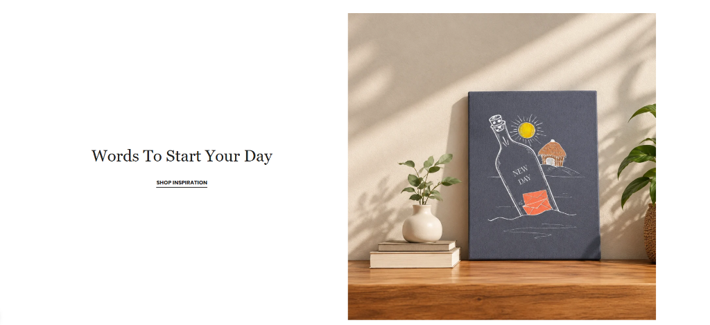

# Image with Text Slider (Editorial Carousel)

An elegant, fully responsive **Image with Text section with an interactive multi-image carousel slider** for Shopify Online Store 2.0 themes. Inspired by modern minimalist DTC brands, art curation studios, and editorial lifestyle lookbooks.

Features a customizable split 2-column layout (Left/Right image position toggle), touch and mouse-drag slider with slide or fade transitions, per-image clickable link options, custom aspect ratio presets, signature editorial underline CTA links, and comprehensive typography/color controls.

---

## ✨ Features

- **Split 2-Column Responsive Layout**:
  - **Desktop Image Position**: Toggle image to **Left** or **Right** with a single click in the theme customizer.
  - **Desktop Width Ratio**: Choose 50/50 balanced split, 40/60 compact image, or 60/40 hero image focus.
  - **Mobile Stack Order**: Choose whether the **Image** or **Text** appears first on mobile screens.
  - **Vertical Alignment**: Align content to Center, Top, or Bottom.
  - **Independent Text Alignment**: Left, Center, or Right alignments set independently for desktop and mobile.
- **Dynamic Multi-Image Slider Carousel**:
  - Add **4–5 or unlimited images** as Shopify blocks (`image_slide`).
  - **Smooth Transitions**: Choose between **Slide** (smooth horizontal glide) or **Fade** (editorial gallery crossfade).
  - **Autoplay**: Optional auto-slide with adjustable speed (2–10 seconds) and auto-pause on hover/touch.
  - **Interactive Navigation**:
    - Prev / Next circular frosted arrow buttons (Always, On Hover Only, or Hidden).
    - Multiple pagination styles: **Interactive Dots**, **Numerical Counter** (e.g. `01 / 04`), or **Bottom Progress Bar**.
  - **Touch Swipe & Mouse Drag**: Smooth gesture navigation on both smartphones, tablets, and desktop drag.
  - **Keyboard Accessible**: Navigate between slides using left/right arrow keys (`a11y` compliant).
- **Per-Image Link Support**:
  - Every image slide can have its own **link URL** (linking to a product, collection, or external lookbook).
  - Optional **Open link in new tab** (`target="_blank" rel="noopener noreferrer"`).
  - Custom SEO & accessibility `alt_text` field per slide.
  - Optional **Floating Slide Badge / Tag** (e.g. `NEW RELEASE`, `FEATURED PIECE`).
- **Aspect Ratio & Frame Styling**:
  - Presets: **Portrait (4:5)**, **Classic Editorial (3:4)**, **Square (1:1)**, **Tall Portrait (2:3)**, **Landscape (3:2)**, **Wide (16:9)**, or **Custom Fixed Height** (in pixels for desktop and mobile).
  - Image fit: `cover` or `contain`.
  - Corner radius: 0px (crisp classic art gallery look) up to 40px (modern rounded).
  - Frame depth: Subtle soft shadow, elevated shadow, or an elegant framed canvas border.
  - Subtle micro-zoom effect on hover.
- **Editorial Typography & Dual CTAs**:
  - **Subheading / Eyebrow**: Customizable text, font size, uppercase casing, and letter spacing.
  - **Main Heading**: Choice of **Classic Serif** (editorial elegance), **Modern Sans-serif**, or theme default font, with desktop and mobile font size sliders.
  - **Body Description**: Rich text format for editorial narrative and storytelling.
  - **Signature Underline CTA Link**: Clean uppercase link with animated underline hover effect (as shown in reference design), or customizable to Solid / Outline button styles.
  - **Optional Secondary Button**: Add a secondary button or link alongside the primary CTA.
- **Zero External Dependencies**:
  - 100% vanilla CSS and custom Web Component (`customElements.define`).
  - No Slick, Swiper, jQuery, or bloated external scripts.
  - Fully scoped CSS (`section_id`) preventing styling collisions across multiple section instances.
  - Built-in SVG lifestyle artwork fallback so the section looks stunning out of the box before images are uploaded.

---

## 🚀 How to Use

1. Copy [`image-with-text-slider.liquid`](image-with-text-slider.liquid) into your Shopify theme's `sections/` directory.
2. In the Shopify Admin, navigate to **Online Store → Themes → Customize**.
3. In any template (Home page, Product page, About page, Editorial Lookbook, etc.), click **Add section**.
4. Search for and select **Image with Text Slider**.
5. Click **Add Image Slide** under the section to upload your images, set image URLs, and customize copy and styles.

---

## ⚙️ Schema Settings

### Layout & Sizing

| Setting | Type | Default | Description |
|---|---|---|---|
| `image_position` | `select` | `right` | `left` (Image Left, Text Right) or `right` (Image Right, Text Left) |
| `desktop_image_width` | `select` | `50` | `40%`, `45%`, `50%`, `55%`, or `60%` |
| `mobile_stack_order` | `select` | `image_first` | `image_first` or `text_first` |
| `container_width` | `select` | `boxed_normal` | `boxed_narrow` (1080px), `boxed_normal` (1280px), `boxed_wide` (1480px), or `full_width` |
| `vertical_alignment` | `select` | `center` | `flex-start` (Top), `center` (Middle), or `flex-end` (Bottom) |
| `column_gap_desktop` | `range` | `60px` | Gap between text and image columns on desktop |
| `column_gap_mobile` | `range` | `32px` | Gap between text and image on mobile |
| `content_max_width` | `range` | `540px` | Max width for the text copy block |

### Image & Carousel Sizing

| Setting | Type | Default | Description |
|---|---|---|---|
| `image_aspect_ratio` | `select` | `portrait` | `portrait` (4:5), `classic` (3:4), `square` (1:1), `tall_portrait` (2:3), `landscape` (3:2), `wide` (16:9), or `custom` |
| `image_custom_height_desktop` | `range` | `560px` | Fixed desktop image height when aspect ratio is `custom` |
| `image_custom_height_mobile` | `range` | `380px` | Fixed mobile image height when aspect ratio is `custom` |
| `image_fit` | `select` | `cover` | `cover` (fills frame) or `contain` (shows whole image) |
| `image_border_radius` | `range` | `0px` | Image corner radius (0px for classic editorial) |
| `image_shadow` | `select` | `none` | `none`, `subtle`, `elevated`, or `art_frame` |
| `enable_image_zoom` | `checkbox` | `true` | Enables subtle zoom on image hover |

### Slider Behaviors & Navigation

| Setting | Type | Default | Description |
|---|---|---|---|
| `slider_animation` | `select` | `slide` | `slide` (Smooth glide) or `fade` (Crossfade) |
| `enable_autoplay` | `checkbox` | `false` | Enables automatic slide advancement |
| `autoplay_speed` | `range` | `5s` | Slide duration before advancing (2–10 seconds) |
| `show_arrows` | `select` | `always` | `always`, `hover_only`, or `never` |
| `pagination_style` | `select` | `dots` | `dots`, `counter` (e.g. `01 / 04`), `progress`, or `none` |

### Typography & Content

| Setting | Type | Default | Description |
|---|---|---|---|
| `subheading` | `text` | `NEW CURATION` | Eyebrow/kicker text above headline |
| `subheading_size` | `range` | `12px` | Subheading font size |
| `heading` | `text` | `Words To Start Your Day` | Main section headline |
| `heading_font_family` | `select` | `serif` | `serif` (Editorial classic), `sans` (Modern), or `theme` |
| `heading_size_desktop` | `range` | `44px` | Desktop heading font size |
| `heading_size_mobile` | `range` | `32px` | Mobile heading font size |
| `heading_tag` | `select` | `h2` | HTML heading tag (`h1`–`h4`, `p`) |
| `body_text` | `richtext` | *Paragraph* | Editorial narrative / body copy |
| `desktop_text_alignment` | `select` | `left` | `left`, `center`, or `right` |
| `mobile_text_alignment` | `select` | `left` | `left`, `center`, or `right` |

### Call to Action (Buttons / Links)

| Setting | Type | Default | Description |
|---|---|---|---|
| `button_label` | `text` | `SHOP INSPIRATION` | Primary CTA text |
| `button_link` | `url` | — | Primary CTA link URL |
| `button_style` | `select` | `underline` | `underline` (Editorial style), `solid`, or `outline` |
| `button_show_arrow` | `checkbox` | `false` | Displays an inline arrow SVG beside the button text |
| `button_open_new_tab` | `checkbox` | `false` | Opens CTA in a new tab |
| `button_2_label` | `text` | — | Optional secondary button text |
| `button_2_link` | `url` | — | Optional secondary button URL |
| `button_2_style` | `select` | `secondary-underline` | `secondary-underline`, `outline`, or `solid` |

### Block Settings (`image_slide`)

| Setting | Type | Default | Description |
|---|---|---|---|
| `image` | `image_picker` | — | Primary desktop image |
| `image_mobile` | `image_picker` | — | Optional mobile-optimized image |
| `link` | `url` | — | Link URL for the whole image slide |
| `link_open_new_tab` | `checkbox` | `false` | Open slide link in a new window/tab |
| `alt_text` | `text` | — | Custom alt text for SEO / accessibility |
| `slide_badge` | `text` | — | Floating label/tag (e.g. `DAILY INSPIRATION`) |
| `badge_position` | `select` | `top-left` | `top-left`, `top-right`, `bottom-left`, or `bottom-right` |

---

## 🎨 Color Customization

Full granular color picker controls in the schema for:
- Section background color
- Heading, Subheading & Body text colors
- Primary & Secondary button text, hover, background, and borders
- Slider arrow icon and background colors (normal & hover)
- Slider pagination dots & progress bar active and inactive colors
- Slide badge background & text colors
- Image placeholder background color

---

## 💡 Pro Tips

1. **Editorial Underline Style**: Leave `button_style` as `underline` for the timeless luxury DTC look seen in editorial and high-end homeware brands.
2. **Clickable Slides**: By setting `link` on each `image_slide` block, visitors can click either the image or the CTA button to visit the collection or product page.
3. **Single Image Mode**: If you only add 1 image slide block, the section automatically hides arrows and pagination, serving as an ultra-fast, clean static Image with Text section.
4. **Theme Editor Live Sync**: When you click on any image slide block in the Shopify Theme Editor sidebar, the slider will automatically scroll to preview that exact slide immediately.
