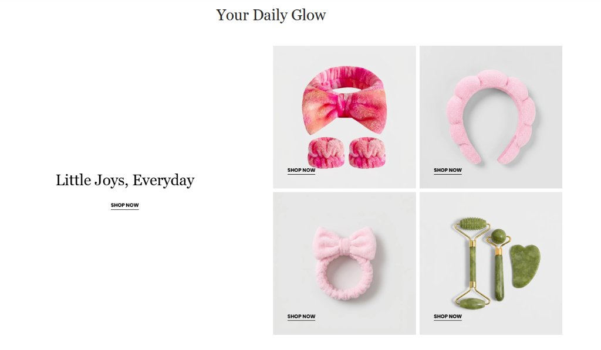

# Product Grid with Text (Editorial DTC Showcase)

An editorial, high-converting **Product Grid with Text section** for Shopify Online Store 2.0 themes. Inspired by clean, aesthetic DTC beauty, skincare, wellness, and lifestyle brands (such as Rhode, Glossier, Summer Fridays, and Merit).

Features a balanced split 2-column layout pairing a brand storytelling text column with a customizable 2x2 or multi-card product grid. Includes individual card links, optional Shopify product catalog integration, signature editorial underline CTAs, and a mobile-optimized experience with grid or touch swipe slider modes.

---

## ✨ Features

- **Split 2-Column Responsive Layout**:
  - **Desktop Column Position**: Toggle between **Text Left, Cards Right** (as seen in the reference) or **Cards Left, Text Right** with one click.
  - **Custom Column Width Ratio**: Choose 35/65 (optimal for 2x2 grid), 30/70, 40/60, 45/55, or 50/50.
  - **Vertical Alignment**: Align text content to **Center**, **Top**, or **Bottom** relative to the cards grid.
  - **Independent Gap & Padding Controls**: Sliders for desktop and mobile column gaps, container max-width (1000px–1600px), and section padding.

- **Top Section Header (Optional)**:
  - Add a centered, left-aligned, or right-aligned top title (e.g. `Your Daily Glow`).
  - Customizable eyebrow/kicker, description, font family (Serif, Sans-Serif, Theme Default), font size, letter spacing, and bottom margins.

- **Storytelling Text Column**:
  - **Heading Typography**: Choose between classic luxury **Editorial Serif**, modern **Sans-Serif**, or your theme's default font.
  - **Granular Font Controls**: Independent sliders for desktop & mobile font sizes, font weights (400–700), and letter spacing.
  - **Text Alignment**: Left, Center, or Right alignments configurable separately for desktop and mobile.
  - **Signature Underline CTA Link**: Clean uppercase link with animated underline hover effect (exact match to reference photo), or switch to **Solid** or **Outline** button styles.
  - **Optional Secondary Button**: Add an additional link or button alongside the primary CTA.

- **Product Image Cards Grid**:
  - **Desktop Columns**: 2 columns (classic 2x2 grid as shown in reference), 1 column, or 3 columns.
  - **Aspect Ratio Presets**: Square (`1:1` - reference style), Portrait (`4:5`), Classic (`3:4`), Tall (`2:3`), or Natural image ratio.
  - **Image Fit & Padding**: `contain` (ideal for product cutouts floating inside cards) or `cover`. Adjustable inner card padding (0px–48px).
  - **Hover Micro-Interactions**: Subtle 1.05x image zoom, card elevation shadow lift, border highlight, or static.
  - **Card Background & Border Radius**: Customizable background color (default soft `#F4F4F4`) and corner radius (0px for editorial edge up to 32px).

- **Dynamic Card Blocks (`product_card`)**:
  - **Shopify Product Integration**: Select an existing Shopify product to automatically fetch its featured image, title, price, and product URL.
  - **Custom Image & Links**: Upload custom campaign images and specify custom links (with optional open in new tab).
  - **Card Button**: Customizable button text (e.g. `SHOP NOW`), custom URL, button style (Underline, Solid, Outline), and position (**Bottom Left on card** as in photo, Bottom Right, Bottom Center, or Below Image).
  - **Whole Card Clickable**: Option to make the entire card surface a clickable link.
  - **Floating Badges**: Add tags like `BESTSELLER`, `NEW`, `SAVE 20%` with custom background and text colors.

- **Mobile Experience & Ordering (Configurable)**:
  - **Mobile Stack Order**:
    - **Cards First, Content Below** (as requested: Section Header → Cards Grid/Slider → Story Text & CTA).
    - **Content First, Cards Below** (Section Header → Story Text → Cards Grid/Slider).
  - **Mobile Card Display Modes**:
    - **Grid Mode**: 1 card per row or 2 cards per row (compact 2-column view).
    - **Touch Slider / Carousel Mode**: Silky smooth native CSS scroll-snap horizontal carousel with card peek effect (70%–100% card width), dot pagination indicators, slide counter (`1 / 4`), and prev/next arrows.

- **Zero External Dependencies**:
  - 100% vanilla CSS & lightweight custom Web Component.
  - No Swiper, Slick, jQuery, or heavy third-party libraries.
  - Scoped CSS (`#shopify-section-{{ section.id }}`) ensuring zero conflicts with your theme.
  - **Clean Blank Canvas / Custom Image Support**: When images are uploaded, renders crisp, responsive `` tags with responsive `srcset`. If no image is selected, displays a clean, minimal blank canvas card container without visual clutter, allowing buttons and copy to shine.

---

## 🚀 How to Install & Use

1. Copy [`product-grid-with-text.liquid`](product-grid-with-text.liquid) into your Shopify theme's `sections/` directory.
2. In your Shopify Admin, navigate to **Online Store → Themes → Customize**.
3. In any page template (Home page, Collection page, Product page, Editorial Lookbook, etc.), click **Add section**.
4. Search for and select **Product Grid with Text**.
5. Add or customize **Product Card** blocks under the section to upload images, link products, and adjust copy.
6. Click **Save**.

---

## ⚙️ Schema Settings

### Top Section Header

| Setting | Type | Default | Description |
|---|---|---|---|
| `show_section_header` | `checkbox` | `true` | Toggle top section header on/off |
| `section_eyebrow` | `text` | — | Eyebrow text above top header |
| `section_header_title` | `text` | `Your Daily Glow` | Main top header title |
| `section_header_tag` | `select` | `h2` | HTML tag (`h1`, `h2`, `h3`, `p`) |
| `section_header_font_family` | `select` | `serif` | `serif` (Editorial), `sans` (Modern), or `theme` |
| `section_header_size_desktop` | `range` | `36px` | Desktop title font size |
| `section_header_size_mobile` | `range` | `28px` | Mobile title font size |
| `section_header_align` | `select` | `center` | `left`, `center`, or `right` |
| `section_header_desc` | `richtext` | — | Optional subtitle / description |

### Desktop Layout & Sizing

| Setting | Type | Default | Description |
|---|---|---|---|
| `desktop_layout` | `select` | `text_left_cards_right` | `text_left_cards_right` or `cards_left_text_right` |
| `desktop_column_ratio` | `select` | `35_65` | `30_70`, `35_65`, `40_60`, `45_55`, or `50_50` |
| `vertical_alignment` | `select` | `center` | `center`, `flex-start` (Top), or `flex-end` (Bottom) |
| `column_gap_desktop` | `range` | `64px` | Space between text and cards column on desktop |
| `column_gap_mobile` | `range` | `32px` | Space between text and cards on mobile |
| `container_max_width` | `range` | `1320px` | Maximum container width |
| `padding_top_desktop` | `range` | `64px` | Section top padding on desktop |
| `padding_bottom_desktop` | `range` | `64px` | Section bottom padding on desktop |
| `padding_top_mobile` | `range` | `40px` | Section top padding on mobile |
| `padding_bottom_mobile` | `range` | `40px` | Section bottom padding on mobile |

### Story Text Column

| Setting | Type | Default | Description |
|---|---|---|---|
| `content_eyebrow` | `text` | — | Kicker text above main heading |
| `content_heading` | `text` | `Little Joys, Everyday` | Main story headline |
| `content_heading_font_family` | `select` | `serif` | `serif` (Editorial), `sans` (Modern), or `theme` |
| `content_heading_size_desktop` | `range` | `42px` | Desktop heading font size |
| `content_heading_size_mobile` | `range` | `30px` | Mobile heading font size |
| `content_body` | `richtext` | — | Supporting narrative / description |
| `desktop_text_alignment` | `select` | `left` | Desktop text alignment (`left`, `center`, `right`) |
| `mobile_text_alignment` | `select` | `left` | Mobile text alignment (`left`, `center`, `right`) |
| `content_max_width` | `range` | `440px` | Maximum width of text content block |
| `primary_btn_label` | `text` | `SHOP NOW` | Primary button text |
| `primary_btn_link` | `url` | — | Primary button destination URL |
| `primary_btn_style` | `select` | `underline` | `underline` (Signature style), `solid`, or `outline` |
| `primary_btn_show_arrow` | `checkbox` | `false` | Display inline arrow SVG icon |
| `secondary_btn_label` | `text` | — | Optional secondary button text |
| `secondary_btn_link` | `url` | — | Optional secondary button URL |

### Product Cards Grid

| Setting | Type | Default | Description |
|---|---|---|---|
| `desktop_cards_per_row` | `select` | `2` | Number of columns on desktop (`1`, `2`, `3`) |
| `grid_gap_desktop` | `range` | `16px` | Gap between cards on desktop |
| `grid_gap_mobile` | `range` | `12px` | Gap between cards on mobile |
| `card_aspect_ratio` | `select` | `square` | `square` (1:1), `portrait_4_5`, `portrait_3_4`, `tall_2_3`, or `auto` |
| `card_image_fit` | `select` | `contain` | `contain` (product cutout inside card) or `cover` |
| `card_padding` | `range` | `24px` | Inner padding around card image |
| `card_border_radius` | `range` | `0px` | Corner radius (0px for editorial edge) |
| `card_hover_effect` | `select` | `zoom` | `zoom` (delicate zoom), `lift` (shadow elevation), `border`, or `none` |
| `enable_whole_card_link` | `checkbox` | `true` | Makes the full card surface clickable |
| `default_card_btn_label` | `text` | `SHOP NOW` | Fallback button text for each card |

### Mobile Experience

| Setting | Type | Default | Description |
|---|---|---|---|
| `mobile_stack_order` | `select` | `cards_first_content_below` | `cards_first_content_below` or `content_first_cards_below` |
| `mobile_card_layout` | `select` | `grid` | `grid` (Clean grid) or `slider` (Swipe carousel) |
| `mobile_cards_per_row` | `select` | `2` | Cards per row when Grid mode is active (`1` or `2`) |
| `mobile_slider_card_width` | `range` | `80%` | Card width percentage in Slider mode (shows peek of next card) |
| `show_mobile_slider_dots` | `checkbox` | `true` | Display pagination dots on mobile slider |
| `show_mobile_slider_arrows` | `checkbox` | `true` | Display prev/next arrows on mobile slider |
| `show_mobile_slider_counter` | `checkbox` | `false` | Display numerical counter (e.g. `1 / 4`) |

### Block Settings (`product_card`)

| Setting | Type | Default | Description |
|---|---|---|---|
| `image` | `image_picker` | — | Custom product or campaign image |
| `product` | `product` | — | Select Shopify product (auto-populates title, image, price, URL) |
| `card_link` | `url` | — | Custom link URL (overrides product URL) |
| `open_in_new_tab` | `checkbox` | `false` | Open link in a new window |
| `title` | `text` | — | Optional custom card title (leave blank for reference look) |
| `subtitle` | `text` | — | Optional card subtitle / brief detail |
| `price` | `text` | — | Custom price display (e.g. `$24.00`) |
| `button_label` | `text` | `SHOP NOW` | Custom button label |
| `button_link` | `url` | — | Custom button link |
| `button_style` | `select` | `underline` | `underline` (Reference style), `solid`, or `outline` |
| `button_position` | `select` | `bottom_left` | `bottom_left` (as in photo), `bottom_right`, `bottom_center`, or `below_image` |
| `badge_text` | `text` | — | Floating card tag (e.g. `BESTSELLER`) |
| `badge_bg_color` | `color` | `#111111` | Badge background color |
| `badge_text_color` | `color` | `#ffffff` | Badge text color |

---

## 🎨 Color Customization

Complete color picker controls in the schema for:
- Section background color
- Top section header title & eyebrow colors
- Content column heading, eyebrow, body, and button colors
- Content button hover background and text colors
- Card background, border, title, and price colors
- Card button label and underline colors (with hover states)
- Mobile slider dots (active/inactive) and arrow buttons

---

## 💡 Pro Tips

1. **Aesthetic DTC Look**: Keep `button_style` set to `underline` and `card_aspect_ratio` set to `square` with `#F4F4F4` background for the iconic luxury skincare aesthetic seen in Rhode and Glossier.
2. **Mobile Slider Peek**: When selecting `slider` mode for mobile, set `mobile_slider_card_width` to `80%`. This provides an intuitive visual cue to customers that more products are available via swiping.
3. **Shopify Product Integration**: If you select a product in the block settings without uploading an image or typing a title, the section automatically extracts the product's primary image, title, price, and direct URL.
4. **Clean Editorial Photography**: For best results, use PNG or JPG product photos with light or transparent backgrounds. The card's built-in padding will center the product gracefully inside the container.

